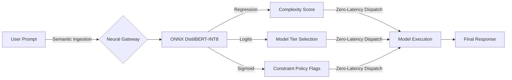

# 🚀 <samp>NexusRoute</samp>: <sub style="color:#38bdf8;">Neural LLM FinOps Infrastructure</sub>

<div align="center">
  <!-- Animated Hero Banner Placeholder -->
  <picture>
    <source media="(prefers-color-scheme: dark)" srcset="https://raw.githubusercontent.com/tandpfun/skill-icons/main/icons/react-dark.svg" width="60" />
    
  </picture>
  <br/>
  <i>Real-time neural routing logic, distilled into a 64MB CPU-executable agent.</i>
</div>

---

### 🧠 <samp>Neural Intelligence Core</samp>



---

### ✨ <samp>System Capabilities</samp>

<div align="center">
  
| Feature | Visual Signal | Tier | Cost Efficiency |
| :--- | :--- | :--- | :--- |
| **Neural Router** | ⚡ Context-Aware | Edge-Pro | 🚀 80% Reduction |
| **Decomposer** | 🧩 Parallel Engine | Hybrid | 🔒 Secure |
| **A/B Arena** | ⚖️ Benchmark ROI | Cloud | 💡 Pareto Opt |
| **Privacy Guard** | 🛡️ Zero-Egress | Edge | 🎯 100% Sovereign |

</div>

---

### 📸 <samp>System Interface Overview</samp>

*Visualizing the operational state of the NexusRoute platform.*

| **Console & Routing** | **Analytics & FinOps** |
| :--- | :--- |
|  |  |
| *Real-time complexity tracing* | *Cost reduction telemetry* |

---

### 🛠️ <samp>Why ONNX Intelligence?</samp>

We engineered NexusRoute to move beyond brittle heuristic keyword matching:

- 🏎️ **< 30ms Inference**: CPU-native execution, zero GPU requirement.
- 📉 **64MB Footprint**: Quantized for enterprise-grade edge deployment.
- 🎯 **Contextual Intent**: Understands code logic vs. math vs. PII sensitivity.

---

### 🚀 <samp>Getting Started</samp>

```bash
git clone https://github.com/cksakthiram2428/NexusRoute.git
cd NexusRoute
npm install
npm run dev
```

---

<div align="center">
  <sub>Built with precision for enterprise AI infrastructure and cost optimization.</sub>
</div>
