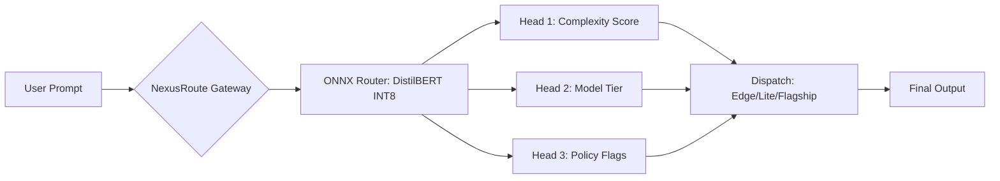

# 🚀 NexusRoute: Neural LLM Cost Optimizer & Router

<p align="center">
  
  
  
  
</p>

NexusRoute is an enterprise-grade AI infrastructure platform that reduces LLM operational costs by up to **80%** using **real-time neural routing**.

---

### 🧠 The Intelligence Pipeline (Real-Time)
*This diagram renders dynamically in GitHub.*



---

### ✨ Core Neural Capabilities

| Feature | Description | Target Model Tier | Cost Efficiency |
| :--- | :--- | :--- | :--- |
| **Neural Routing** | Uses a quantized DistilBERT INT8 model to classify prompt intent and complexity in <30ms. | Edge to Pro | 🚀 80% Reduction |
| **Multi-Part Decomposer** | Splits complex compound prompts into distinct sub-tasks for parallel execution. | Hybrid Multi-Model | 🔒 Zero-Egress Compliant |
| **A/B Model Arena** | Real-time benchmarking comparing correctness, reasoning depth, and token ROI. | Gemini 2.5 Pro vs GPT-4o | ⚖️ Pareto Frontier |
| **PII/Zero-Egress** | Automatically traps sensitive PII, SSN, or confidential queries for on-device local execution. | Local Edge Engine ($0) | 🛡️ 100% Sovereignty |

---

### 🛠️ Why ONNX?
We moved from fragile heuristic regex matching to a **64MB quantized Neural Router** that executes on the CPU:
- **Zero GPU Dependency**: Runs within your existing Node.js process.
- **Latency**: Adds negligible overhead (<30ms) to the query lifecycle.
- **Accuracy**: Understands context and semantic intent, not just keywords.

---

### 📦 Quickstart & Development

```bash
# Clone
git clone https://github.com/cksakthiram2428/NexusRoute.git
cd NexusRoute

# Install dependencies
npm install

# Run development server
npm run dev

# Build for production
npm run build
```

---

*Built with precision for enterprise AI infrastructure and cost optimization.*
